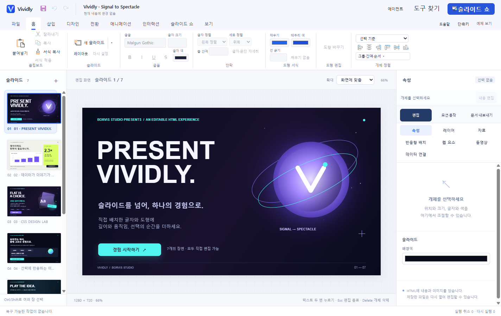

# Vividly

**Present Vividly.**

텍스트·도형·이미지·차트를 화면에서 배치하고, CSS 디자인과 모션·인터랙션을 더해 **HTML로 공유하는 Windows 프레젠테이션 편집기**입니다.

[소개 페이지](https://boduri83.github.io/vividly_html_slide_maker_op/) · [Windows 다운로드](https://github.com/boduri83/vividly_html_slide_maker_op/releases/tag/v0.24.0-beta.5) · [쇼케이스 체험](https://boduri83.github.io/vividly_html_slide_maker_op/examples/first-deck.html) · [5분 시작 안내](https://boduri83.github.io/vividly_html_slide_maker_op/start.html)

## 주요 기능

- **화면에서 직접 편집** — 글자·도형·이미지·차트의 위치, 크기와 서식을 조절합니다.
- **CSS 디자인과 모션** — 그라데이션·그림자·글래스 효과와 등장 효과·키프레임·장면 전환을 편집합니다.
- **반응하는 발표 자료** — 클릭·키보드 입력·선택값에 따라 내용과 개체 상태를 바꾸고 원하는 페이지로 이동합니다.
- **디자인 재사용** — 마스터·레이아웃·스타일·컴포넌트·자산을 활용하고 다른 자료에서도 가져옵니다.
- **HTML 저장·재편집·발표** — 저장한 자료를 Vividly에서 다시 편집하고, 완성한 HTML은 브라우저에서도 발표합니다.
- **선택적 에이전트 협업** — Codex·모델 API 또는 MCP를 연결해 자료 제작을 함께 진행합니다.

일반 수동 편집·저장·발표는 오프라인으로 사용할 수 있으며 AI 계정이나 API 키가 필요하지 않습니다.

## 다운로드

**Windows x64 · 무료 공개 베타 `0.24.0-beta.5`**

| 배포 방식 | 다운로드 | 사용 방법 |
| --- | --- | --- |
| 설치형 | [Windows 설치 프로그램 (.exe)](https://github.com/boduri83/vividly_html_slide_maker_op/releases/download/v0.24.0-beta.5/Vividly-0.24.0-beta.5-Setup-x64.exe) | 현재 사용자 계정에 설치하고 시작 메뉴에서 실행 |
| 포터블 | [ZIP 버전](https://github.com/boduri83/vividly_html_slide_maker_op/releases/download/v0.24.0-beta.5/Vividly-0.24.0-beta.5-Windows-x64.zip) | 압축을 모두 푼 뒤 `Vividly.exe` 실행 |

설치형은 관리자 권한 없이 설치할 수 있습니다. 현재 배포물은 개발자 서명이 없는 초기 베타이므로 Windows에서 경고가 표시될 수 있습니다. 파일 해시와 변경 사항은 [릴리스 안내](https://github.com/boduri83/vividly_html_slide_maker_op/releases/tag/v0.24.0-beta.5)에서 확인하세요.

## 첫 자료 만들기

1. 앱을 열어 **「Signal to Spectacle」 7장 쇼케이스**를 살펴봅니다. 슬라이드 쇼에서 모션·선택 버튼·숫자 키 동작을 체험하세요.
2. 편집 화면에서 제목을 두 번 눌러 바꾸고, 도형을 옮기거나 차트 값을 수정합니다.
3. **Ctrl+S**로 HTML을 저장하고 **Ctrl+O**로 다시 엽니다. 수정한 뒤 **슬라이드 쇼**로 발표하세요.

[5분 시작 안내](docs/usage/first-five-minutes.md)에서 따라 할 수 있습니다. Vividly에서 만든 편집용 HTML·JSON을 다시 열 수 있습니다. 임의 웹페이지의 편집용 가져오기와 PPTX·ODP 가져오기는 지원하지 않습니다. 용량·글꼴·미디어 관련 안내는 [사용·지원 안내](SUPPORT.md)를 확인하세요.

## 도움과 피드백

[사용·지원 안내](SUPPORT.md) · [개인정보·데이터 안내](PRIVACY.md) · [첫 사용 후기](https://github.com/boduri83/vividly_html_slide_maker_op/issues/new?template=feedback.yml) · [오류 제보](https://github.com/boduri83/vividly_html_slide_maker_op/issues/new?template=bug_report.yml) · [기능 제안](https://github.com/boduri83/vividly_html_slide_maker_op/issues/new?template=feature_request.yml)

GitHub Issues는 공개됩니다. API 키·고객 정보·민감한 원본 자료는 올리지 마세요. 문서나 사용 기록을 자동으로 제보하지 않습니다.

## 개발

소스에서 실행하거나 프로젝트에 기여하려면 [개발 안내](docs/development/repository.md)를 참고하세요.

## 라이선스와 제작

Vividly 자체 코드는 [MPL-2.0](LICENSE)을 따릅니다. 제3자 구성 요소의 라이선스는 [고지](NOTICE.md)를 확인하세요. 앱의 라이선스가 사용자의 발표 내용에 자동으로 적용되지는 않습니다.

**Borvis Studio · 기획·제작: 보들이** · [보들이 GitHub](https://github.com/boduri83)
